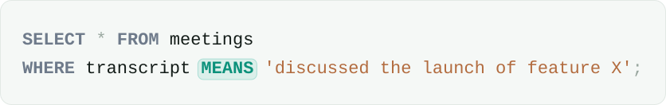

<!-- PROJECT LOGO -->
<br />
<div align="center">
  <picture>
    <source media="(prefers-color-scheme: dark)" srcset="assets/semcast-logo-dark.svg">
    
  </picture>
</div>

<div align="center">
  <picture>
    <source media="(prefers-color-scheme: dark)" srcset="assets/hero-query-dark.svg">
    
  </picture>
</div>

<div align="center">
  <p align="center">
    A semantic SQL query engine you connect to with a Postgres client.
    <br />
    <br />
    <a href="https://github.com/robintiman/semcast/issues/new?labels=bug">Report Bug</a>
    &middot;
    <a href="https://github.com/robintiman/semcast/issues/new?labels=enhancement">Request Feature</a>
  </p>
</div>

## About

Semcast is a semantic SQL query engine served over the Postgres wire
protocol. It adds meaning to SQL: filter text by what it says, extract
typed fields from it, index it by similarity.

## Getting Started

### Prerequisites

Pick a provider:

* **Ollama** (default, local, free) — `ollama pull gemma4:e4b` plus
  `nomic-embed-text`. Completions and embeddings, no API key.
* **Anthropic** — `export ANTHROPIC_API_KEY=...`; defaults to `claude-haiku-4-5`, the right
  tier for one-word verify calls. No embeddings, so pair with Ollama or Voyage
  to index. Select with `--provider anthropic`.
* **Voyage** — `export VOYAGE_API_KEY=...`; hosted embeddings for the semantic
  index. Select with `--embed-provider voyage`.

### Installation

Prebuilt binary (Linux x86_64, macOS Apple Silicon), no Rust toolchain needed:

```sh
curl --proto '=https' --tlsv1.2 -LsSf https://github.com/robintiman/semcast/releases/latest/download/semcast-installer.sh | sh
```

Or download a tarball from the
[latest release](https://github.com/robintiman/semcast/releases/latest).
Then start the server and connect with a Postgres client:

```sh
semcast serve                                                 # fully local (Ollama)
semcast serve --provider anthropic --embed-provider voyage    # hosted
psql -h 127.0.0.1 -p 5433
```

Simple query protocol only for now: `psql` works; DBeaver, JDBC and Grafana
need the extended protocol (on the [roadmap](#roadmap)).

Build from source:

```sh
git clone https://github.com/robintiman/semcast && cd semcast
cargo run -- serve                                 # build and start the server
cargo test                                         # full suite, no network
cargo test --test live_ollama -- --ignored         # end-to-end against local Ollama
```

### Configuration

Flags of `semcast serve`:

| Flag | Default | |
|------|---------|---|
| `--host` | `127.0.0.1` | listen address |
| `--port` | `5433` | leaves a local Postgres on 5432 alone |
| `--provider` | `ollama` | completions: `ollama` or `anthropic` |
| `--model` | per provider | `gemma4:e4b` (Ollama), `claude-haiku-4-5` (Anthropic) |
| `--scorer-model` | off | small Ollama model that pre-filters an unindexed `MEANS` under [`WITH RECALL`](#with-recall) |
| `--embed-provider` | `ollama` | embeddings: `ollama` or `voyage` |
| `--embed-model` | `nomic-embed-text` | Ollama embedding model |
| `--voyage-model` | `voyage-4-large` | Voyage embedding model |
| `--ollama-url` | `http://localhost:11434` | |
| `--store` | memory only | SQLite file; see [Persistence](#persistence) |
| `--jobs-dir` | temp dir | batch job state and results |
| `--max-in-flight` | `8` | model requests in flight across all queries; a separate embedder gets its own cap; identical requests are sent once |
| `--max-concurrent-jobs` | `4` | `SUBMIT`ted jobs running at once |

### Persistence

Set `--store semcast.db` to keep state across restarts:

* **Verdicts.** One paid for once is free after the restart.
* **Definitions.** Databases, schemas, external tables, views, semantic types,
  semantic indexes and semantic columns come back.
* **Indexes** come back without re-embedding: their vectors are kept in the
  same file. Set `--jobs-dir` to a directory that outlives the temp dir to
  keep job results too.
* **Not kept:** in-memory tables (`CREATE TABLE ... AS`) and the views and
  indexes over them.

A view must read files by absolute path (`FROM '/data/t.csv'`) or through an
external table. A definition that fails to restore, such as a table whose file
is gone or a view whose table was dropped, is logged and kept until the name
is defined again or dropped (`DROP ... IF EXISTS`).

## Usage

### SQL reference

Everything semcast adds to SQL. All other SQL is DataFusion, unchanged: see
[DataFusion's SQL reference](https://datafusion.apache.org/user-guide/sql/index.html).

#### `MEANS`

```sql
<text_column> MEANS '<natural-language condition>'
```

True when a model reading the text would say the condition holds. As a
top-level `AND` conjunct of `WHERE` it filters, and only there can it prune
(index, scorer, `WITH RECALL`). Other predicates in the same `WHERE` run
first, so the model only sees their survivors.

```sql
SELECT meeting_id, title FROM meetings
WHERE held_at >= CAST('2026-01-01' AS TIMESTAMP)
  AND transcript MEANS 'discussed the launch of offline sync in Atlas';
```

A question asked before is answered from the store first: every row whose
verdict is stored skips the model, a stored match is never pruned by the index,
and a stored full-text answer beats the excerpt-based check an index would
otherwise run. `EXPLAIN` shows the lookup (`StoreLookupExec: ask=…`), and the progress
notice says how many rows the store answered.

Several `MEANS` in one `WHERE` are ordered by what they cost, not by the order
you wrote them: one whose column has a semantic index prunes for free, so it
runs before one that pays for every row.

Several over the *same* column are asked in **one call per row** instead of one
call per predicate per surviving row — the same fusion a `CASE` gets. An
indexed column keeps its stack instead, since pruning rows beats a floor of one
call each. Fused verdicts are cached under their own key, so a query that fuses
does not reuse verdicts cached by a single-condition query.

`MEANS` also works anywhere else an expression does: under `NOT` or `OR`, as a
`GROUP BY` key, inside an aggregate or window function. There it can't prune,
so every row reaching it is asked; `EXPLAIN` shows the cost. In
`a OR x MEANS '…'`, rows `a` already matches skip the model. Text that is NULL
has no verdict (NULL, as with `LIKE`), so `NOT` doesn't keep it.

```sql
SELECT id FROM tickets
WHERE priority = 'urgent' OR body MEANS 'threatens to cancel';

SELECT CASE WHEN body MEANS 'customer is angry' THEN 'angry' ELSE 'calm' END
         AS mood, count(*)
FROM tickets GROUP BY 1;
```

Refused, because the `MEANS` would have to stay inside a join — compute it as
a column in a subquery first:

* on the kept side of an outer join's `ON` (`t` in
  `t LEFT JOIN c ON … AND t.body MEANS …`);
* inside a correlated subquery (`EXISTS`, `IN`) that reads the outer query's
  columns or shares an `OR` with the correlation.

`UPDATE` and `DELETE` refuse `MEANS`, `CONFIDENCE()` and subqueries in their
`WHERE` (DataFusion would apply them to every row). Keep the other rows
instead:

```sql
CREATE TABLE open_tickets AS SELECT * FROM tickets
WHERE id NOT IN (SELECT id FROM tickets WHERE body MEANS 'resolved');
```

#### `CREATE SEMANTIC INDEX`

```sql
CREATE SEMANTIC INDEX ON <table>(<column>);
```

Chunks each value, embeds the chunks, keeps the vectors in the store (or in
memory without `--store`), and gives `MEANS`
a cheap stage: one embedding call per query prunes non-candidates by vector
similarity, and the verify model reads each survivor's top-3 chunks instead
of the whole document. Optional for `MEANS` but highly recommended; required
by `RELEVANCE TO`, `GROUP BY MEANING OF` and `SEMANTIC DISTINCT ON`.

No `DROP` or `REFRESH` yet: run it again to rebuild after a load.

#### `MEANS` in a `SELECT` list

```sql
<text_column> MEANS '<condition>'                    -- a boolean column
CASE WHEN <text_column> MEANS '<condition>' THEN ... -- a label
```

The same operator, used to label rather than to filter. Every condition over
one column is fused into **one model call per row**, so a three-branch `CASE`
costs what a one-branch one does. `CASE` semantics are unchanged:
first-match-wins, `ELSE`, and a failed row falls through instead of failing the
query.

Ordinary `WHEN` conditions before the first `MEANS` branch run first — rows
they already claimed cost nothing.

```sql
SELECT id, CASE WHEN status = 'closed'             THEN 'archived'
                WHEN body MEANS 'customer is angry' THEN 'escalate'
                WHEN body MEANS 'asks about pricing' THEN 'sales'
                ELSE 'other' END AS route
FROM tickets;

SELECT id, body MEANS 'customer is angry' AS is_angry FROM tickets;
```

Each column answers exactly what the same `MEANS` answers in a `WHERE`, so
verdicts are shared: filter first and label after, and the labelling is free.
No index is used — labelling every row prunes nothing.

#### `CONFIDENCE()`

```sql
CONFIDENCE(<text_column> MEANS '<condition>')   -- a DOUBLE in [0, 1]
```

The model's probability that the `MEANS` holds, read from its yes/no answer.
Goes wherever `MEANS` does. One model call per row,
never fused, and shared with the same `MEANS` in a `WHERE`: whichever runs
first pays.

```sql
SELECT id, CONFIDENCE(body MEANS 'customer is angry') AS anger
FROM tickets
WHERE CONFIDENCE(body MEANS 'customer is angry') > 0.8
ORDER BY anger DESC;
```

NULL when the text is NULL, the call fails, or the provider reports no
probabilities (Ollama does; Anthropic doesn't). `ORDER BY … DESC` puts NULLs
first; add `NULLS LAST`. Not to be confused with `WITH CONFIDENCE`, which
qualifies a recall target.

#### Semantic columns

```sql
ALTER TABLE <table> ADD SEMANTIC COLUMN <name> AS (<text_column> MEANS '<condition>');
ALTER TABLE <table> DROP SEMANTIC COLUMN [IF EXISTS] <name>;
REFRESH SEMANTIC COLUMN <table>(<name>);
EXPLAIN REFRESH SEMANTIC COLUMN <table>(<name>);
```

A named `MEANS`, read like any column. Nothing is stored in the table: reading
the column asks the question for every row that has no stored answer yet, and
the answers are kept, so the second read is free. It is the same question as
the `MEANS` it names — `WHERE angry` plans exactly like
`WHERE body MEANS 'the customer is angry'`, index and all, and either pays for
the other. `REFRESH` pays ahead of time, for every row.

```sql
ALTER TABLE tickets ADD SEMANTIC COLUMN angry AS (body MEANS 'the customer is angry');
SELECT id, angry FROM tickets;
SELECT count(*) FROM tickets WHERE angry;
```

`EXPLAIN REFRESH` shows the bill before you pay it, asking the model nothing:
rows, distinct texts, how many the store already answers, how many would be
asked, the estimated tokens, and the estimated cost at the model's list price
(NULL for a model semcast has no price for; $0 for Ollama; a fallback chain at
its first model's price). Estimates: four characters a token, each answer at
its output cap (an upper bound), list prices as of `prices_as_of`, no batch or
cache discounts. A text that repeats within a batch is asked once.

Saved with `--store` on a saved table, and dropped with its table. Writes go
to the table underneath: `INSERT` names its columns (`INSERT INTO tickets (id,
body) ...`), since a semantic column has no value to give; `UPDATE` can't set
one; and `DELETE`/`UPDATE` can't filter on one, as they can't on `MEANS`.

#### `WITH RECALL`

```sql
<statement> WITH RECALL <fraction>
```

Requires a `MEANS`. Calibrates the index-pruning
threshold instead of guessing it. The scan labels a sample of surviving rows and sets the floor so
the given fraction of true matches survive. Without it, thresholds are best-effort.

The labels also train a small classifier over vectors the index already
holds, and the scan thresholds its probability instead of raw similarity — no
extra embedding or model call. Too few labels, or all one class, and it falls
back to similarity.

The target covers the whole funnel, not just the floor. On an indexed column
verify reads each row's best chunks, so calibration also asks that chunked
question of every sampled match (one call each): a match it misses, or fails
on, counts as lost. If chunks lose too many matches to meet the target,
verify reads the full text for that query, and the progress notice says so.

```sql
SELECT meeting_id FROM meetings
WHERE transcript MEANS 'discussed offline sync'
WITH RECALL 0.9;
```

No index on the column? Start the server with `--scorer-model <small Ollama
model>` and `WITH RECALL` uses it instead: the scorer reads every row and
gives its P("yes"), the main model labels a sample, and only rows above the
calibrated floor reach the main model. A row the scorer can't score is
verified anyway. Without `WITH RECALL` the scorer is never asked.

#### `WITH CONFIDENCE`

```sql
<statement> WITH RECALL <fraction> WITH CONFIDENCE <fraction>
```

Requires a `WITH RECALL`. Turns the target from a point estimate on the sample
into a bound certified for the population: the floor is the one whose Wilson
lower bound clears the target, corrected across the floors considered because
the same sample both picks and scores them.

Certifying costs more and prunes less — that is the trade. The sample grows a
tranche at a time until the bound clears, and if it never does, the funnel
widens to keep every match it can rather than reporting a number it cannot
defend. `EXPLAIN` says which promise a plan makes: *estimated* or *certified
at*.

`WITH RECALL 1 WITH CONFIDENCE …` is rejected — no finite sample proves that
every match survives. Ask for 0.99.

```sql
SELECT meeting_id FROM meetings
WHERE transcript MEANS 'discussed offline sync'
WITH RECALL 0.9 WITH CONFIDENCE 0.95;
```

A sample without a single match certifies nothing: the stage keeps labeling,
up to 256 rows, then prunes nothing.

#### `RELEVANCE TO`

```sql
ORDER BY <text_column> RELEVANCE TO '<natural-language query>' LIMIT <k>
relevance(<text_column>, '<natural-language query>')   -- the score, as a value
```

Orders rows by how well the text answers the query, best first. Two stages:
the index picks 4× `k` candidates (at least 32) by similarity, then one model
call each scores them 0–1. Cost tracks `k`, not the table.

`LIMIT` and a semantic index are both required — without either, ranking is
one model call per row of the whole table. The result is an approximate
top-`k`: a row the index didn't surface as a candidate can't win.

```sql
SELECT meeting_id, title FROM meetings
ORDER BY transcript RELEVANCE TO 'offline sync' LIMIT 10;

SELECT meeting_id, relevance(transcript, 'offline sync') AS score
FROM meetings ORDER BY score DESC LIMIT 10;
```

The two forms are the same plan; `relevance()` also makes the score a value
you can select. A bare `ORDER BY relevance(...)` sorts best-first — write
`ASC` for worst-first.

#### `GROUP BY MEANING OF`

```sql
GROUP BY MEANING OF <text_column> [INTO <k>] [AS <label>]
meaning_of(<text_column> [, <k>])   -- the label, as a value
```

Groups rows by what they are about, when you don't already know the
categories. Two stages: the index's vectors are clustered, then one model
call per group reads its most central documents and names it. Cost tracks the
number of groups, not rows.

`INTO k` fixes the group count; without it, semcast sweeps a few values and
keeps the best-separated. Clustering is seeded, so the same corpus always
gives the same groups. A semantic index is required, and the operator blocks —
which group a row belongs to is a fact about the whole table.

```sql
SELECT topic, count(*) FROM meetings
GROUP BY MEANING OF transcript INTO 8 AS topic;
```
```
         topic                | count
------------------------------+-------
 Billing errors and refunds   |     3
 Offline sync launch timing   |     3
```

`AS` names the label column so the `SELECT` list can use it. Rows the index
hasn't seen get a NULL label rather than disappearing. Use `ONEOF` on a
[semantic type](#create-semantic-type) instead when you already know the
categories — it's one call per row but needs no index.

#### `SEMANTIC DISTINCT ON`

```sql
SELECT SEMANTIC DISTINCT ON (<text_column>) ... [WITH SIMILARITY <fraction>]
```

Collapses rows that say the same thing. The cheapest thing semcast does —
**no model calls at all**: the index already knows how alike two documents
are, and "duplicate" is a threshold on that.

`WITH SIMILARITY` sets that threshold, defaulting to `0.9`. Higher is
stricter. Otherwise this is Postgres's `DISTINCT ON`: one row survives per
group, and `ORDER BY` decides which.

```sql
SELECT SEMANTIC DISTINCT ON (body) id, body FROM notes
WITH SIMILARITY 0.8;
```
```
 id |                     body
----+----------------------------------------------
  1 | my refund has still not arrived
  4 | the product launch slipped to the fourth quarter
  5 | an outage took the dashboard down for an hour
```

A semantic index is required. Rows it hasn't seen fall back to exact-match
dedupe rather than being collapsed on a guess — an index gap leaves
duplicates in, never data out.

#### `CREATE SEMANTIC TYPE`

```sql
CREATE SEMANTIC TYPE <Name> AS (
  <field> <type> '<doc line>',
  ...,
  TOGETHER ( <field> <type> '<doc>', <field> <type> '<doc>' )
);
```

Names a recurring extraction: fields, types, one doc line each (required).
semcast synthesizes the prompt and constrains decoding.

| Field type | Meaning |
|------------|---------|
| `TEXT` | prose |
| `INT`, `BOOL` | plain values |
| `REAL` | number; `CHECK (a..b)` validates at decode time |
| `ONEOF(a, b, c)` | closed category; `GROUP BY`-able |
| `LEVEL(a, b, c)` | ordered low→high |
| `T[]` | list of any of the above |

Fields are extracted independently. `TOGETHER` groups (two or more fields) are generated in
one shot, never pruned apart.

Remove one with `DROP SEMANTIC TYPE [IF EXISTS] <Name>`.

#### `CAST` and `EXTRACT`

```sql
CAST(<text_column> AS <SemanticType>)          -- all fields, as a struct
CAST(<text_column> AS <SemanticType>).<field>  -- one field
EXTRACT(<field> <type> '<doc>' FROM <text_column>)  -- one-off, no type needed
```

Run the extraction a semantic type describes; `EXTRACT` inlines a single
field without declaring a type first. Allowed in the `SELECT` list only.
Standard `EXTRACT(YEAR FROM ts)` is untouched.

```sql
SELECT CAST(transcript AS MeetingFacts).launch_stage FROM meetings;
SELECT EXTRACT(products TEXT[] 'product names discussed' FROM transcript) FROM meetings;
```

#### `SUBMIT`, `CANCEL JOB`, `job_result()`

```sql
SUBMIT <statement>                 -- returns a job_id
SELECT ... FROM semcast_jobs       -- status, rows, model_calls, progress, error, ...
SELECT * FROM job_result('<job_id>')
CANCEL JOB '<job_id>'
```

Runs one statement detached from the connection, so a dropped link doesn't
throw away model calls already made. `status` is `queued`, `running`,
`succeeded`, `failed`, `cancelled` or `interrupted`.

Results are Parquet under `--jobs-dir`, so they never have to fit in memory
and finished jobs stay queryable across restarts. `--max-concurrent-jobs`
caps how many run at once; the rest wait in `queued`. Set it to what your
provider serves concurrently — against a single local model, more jobs is
slower, not faster.

A restart marks a job still in flight as `interrupted` rather than re-running
it: a job can be a CTAS or `CREATE SEMANTIC INDEX` that already partly
applied, so resuming is not idempotent and stays your call.

### Examples

**Ingest**

Query local Parquet and CSV by path, mount them as tables, or materialize
them into memory. Paths resolve on the server. Object storage (s3) is on the
roadmap.

```sql
SELECT * FROM 'data/meetings.parquet';
SELECT count(*) FROM 'data/part-*.parquet';

CREATE EXTERNAL TABLE meetings STORED AS CSV LOCATION 'data/meetings.csv'
  OPTIONS ('format.delimiter' ';');            -- header on by default

CREATE TABLE mem AS SELECT * FROM 'data/meetings.csv';
```

**Index**

```sql
CREATE SEMANTIC INDEX ON meetings(transcript);
```

**Query**

The date filter runs free, the index prunes by similarity, the
model verifies the few survivors.

```sql
SELECT meeting_id, title FROM meetings
WHERE held_at >= CAST('2026-01-01' AS TIMESTAMP)
  AND transcript MEANS 'discussed the launch of offline sync in Atlas'
WITH RECALL 0.9;
```

Follow up with typed extraction — the `MEANS` verdicts are already cached,
so the model runs only to extract from the survivors:

```sql
CREATE SEMANTIC TYPE MeetingFacts AS (
  products  TEXT[] 'product names discussed in this meeting',
  decisions TEXT[] 'concrete decisions that were made',
  TOGETHER (
    launch_stage ONEOF(none, idea, planned, scheduled, shipped)
                       'the furthest launch stage discussed',
    stage_quote  TEXT  'the transcript line that shows that stage'
  )
);

SELECT meeting_id, CAST(transcript AS MeetingFacts).launch_stage AS stage
FROM meetings
WHERE transcript MEANS 'discussed the launch of offline sync in Atlas';
```

**Persist**

Save results as tables or files:

```sql
CREATE TABLE launches AS
  SELECT meeting_id, title FROM meetings
  WHERE transcript MEANS 'discussed the launch of offline sync in Atlas';

COPY launches TO 'out/launches.parquet' STORED AS PARQUET;
```

**Run it as a batch job**

A `MEANS` predicate is one model call per surviving row, and
`CREATE SEMANTIC INDEX` embeds a whole corpus — runs that take minutes to
hours. `SUBMIT` detaches the work from the connection, so a dropped link
doesn't throw away model calls already made:

```sql
SUBMIT SELECT meeting_id, title FROM meetings
       WHERE transcript MEANS 'discussed the launch of offline sync in Atlas'
       WITH RECALL 0.9;
```
```
         job_id
-------------------------
 job_1753711331000_0000
```

Disconnect, come back later, and poll with ordinary SQL — `semcast_jobs` is a
real table, so it filters, sorts, and joins like any other:

```sql
SELECT status, rows, model_calls, progress
FROM semcast_jobs
WHERE job_id = 'job_1753711331000_0000';

SELECT * FROM job_result('job_1753711331000_0000');
```

## Roadmap

- [x] `MEANS` — planner-integrated semantic predicate with batched verify
- [x] `CREATE SEMANTIC INDEX` — vector pre-filter stage, vectors kept in the store
- [x] `WITH RECALL` — sampled threshold calibration
- [x] Semantic types — `CREATE SEMANTIC TYPE`, `CAST`/`EXTRACT`, constrained decoding, field pushdown
- [x] pgwire server (simple protocol) with funnel progress as NOTICE messages
- [x] Ingestion — Parquet/CSV on disk: path-literal `SELECT`, `CREATE EXTERNAL TABLE`, CTAS, `COPY TO`
- [x] Batch jobs — `SUBMIT` a statement, poll `semcast_jobs`, read `job_result()`
- [x] Persistent, cross-session verdict cache and catalog — `--store`
- [x] Rank — `ORDER BY … RELEVANCE TO … LIMIT k` and `relevance()` as a
      two-stage funnel: index similarity picks the candidates, a rerank pass
      orders them
- [x] Classify — `MEANS` in a `SELECT` list or a `CASE` branch, all branches
      fused into one model call per row
- [x] Semantic columns — `ALTER TABLE … ADD SEMANTIC COLUMN … AS (… MEANS …)`,
      a named question whose answers are stored; `REFRESH SEMANTIC COLUMN`
- [x] `CONFIDENCE(… MEANS …)` — the model's P("yes") as a column, sharing the
      `MEANS` cache
- [x] Cluster — `GROUP BY MEANING OF … INTO k`, one model call per group,
      auto-`k` by silhouette sweep
- [x] Semantic dedupe — `SEMANTIC DISTINCT ON … WITH SIMILARITY`, no model
      calls at all
- [ ] Run artifacts — a query returns rows; the evidence lands beside it. Per-run
      table of calls, cost and funnel counts, plus a per-row table of verdict,
      margin and the chunk that decided it, joinable back to the result
- [ ] Eval harness — calls saved and recall vs. the LLM-on-every-row baseline
- [ ] Extended protocol (DBeaver, Grafana, JDBC)
- [ ] Object storage (s3)
- [ ] Semantic join — `JOIN … ON a MEANS MATCH b` for entity resolution and
      schema mapping. Needs `means()` to accept a second column instead of only a
      literal, and an index-blocked candidate stage so it isn't a cross product
- [ ] Incremental semantic index — `REFRESH SEMANTIC INDEX`, reindexing only
      rows whose text changed, so an index survives the next load instead of
      being rebuilt from scratch
- [ ] `CREATE SEMANTIC PREDICATE` — reusable templates with `CHEAP USING` shortcuts
- [ ] Nested semantic types — lists of structs, so one document extracts to N
      correlated rows (line items on an invoice, products in a catalog page)
      instead of parallel `T[]` fields; `LEVEL` ordering semantics
- [ ] `BUDGET` — hard cost caps per query

Want something moved up? [Open an issue](https://github.com/robintiman/semcast/issues).

## Contributing

Feedback is as valuable as code. What are you querying? What syntax did you
expect that didn't work? [Bug reports][bug-url], [feature
requests][feature-url], and real usage examples all shape the roadmap.

Code contributions:

1. Fork, branch (`git checkout -b feature/thing`)
2. `cargo test`
3. Open a pull request

## License

Distributed under the Apache-2.0 License. See `LICENSE` for more information.

## Contact

Robin Timan — robintiman@gmail.com

Project Link: [https://github.com/robintiman/semcast](https://github.com/robintiman/semcast)

## Acknowledgments

* [LOTUS](https://github.com/lotus-data/lotus) — pioneered the calibrated-cascade technique
* [Apache DataFusion](https://datafusion.apache.org/) — the query engine semcast extends

<!-- MARKDOWN LINKS & IMAGES -->
[bug-url]: https://github.com/robintiman/semcast/issues/new?labels=bug
[feature-url]: https://github.com/robintiman/semcast/issues/new?labels=enhancement
